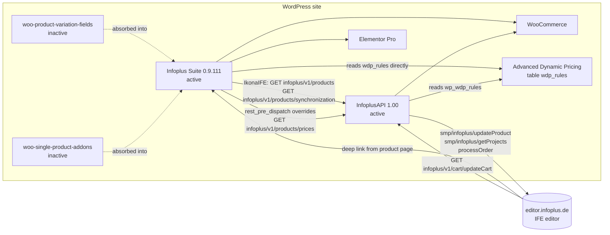
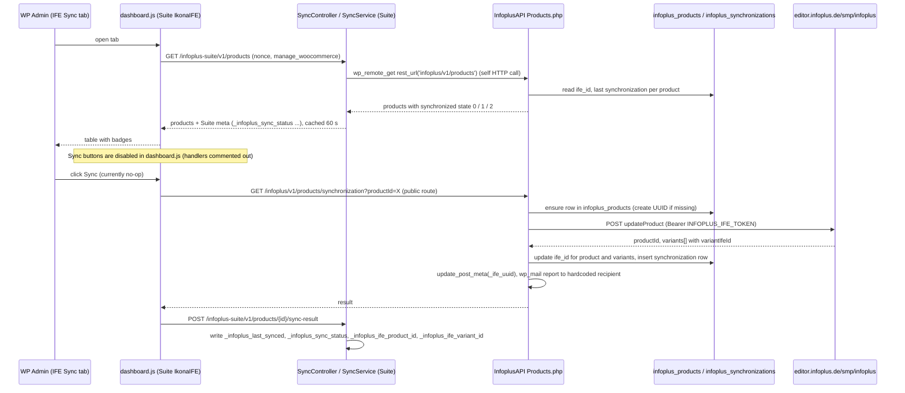

# Infoplus: How the System Fits Together

> **Written:** 2026-09-17 against Infoplus Suite 0.9.111 (commit `f01aca6`) and the InfoplusAPI copy in `reference/infoplus_api/`.
> **Scope:** the four WordPress plugins, the external editor, and the flows that cross plugin boundaries. Module internals are in `PLUGIN-DOCUMENTATION.md`.
> **Rule:** every statement here was read in the code. Where the code does not say, the text says "unverified".

---

## 1. The four plugins

| Plugin | Location in repo | Status on production | Role |
|--------|------------------|----------------------|------|
| **Infoplus Suite** (`infoplus-suite`) | root, `src/` | active, version 0.9.111 | Everything customer-facing: product page widgets, account pages, orders, cart and checkout styling, 404 page, admin sync dashboard. Nine modules. |
| **InfoplusAPI** (`InforplusAPI.php`) | `reference/infoplus_api/` | active, version 1.00, author Vaclav Rezabek | REST bridge to the external editor at editor.infoplus.de: product sync, cart entry from the editor, order hand-off, customer dashboard data. Owns the custom tables `infoplus_products` and `infoplus_synchronizations`. |
| **woo-product-variation-fields** (`qc-product-fields.php`, v1.7.3) | `reference/legacy/` | inactive | Predecessor of the Suite module `WooProductVariationFields`. |
| **woo-single-product-addons** (`woo-simple-variations-list.php`, v1.9.1) | `reference/legacy/` | inactive | Predecessor of the Suite module `WooSingleProductAddons`. The five JS files in `reference/legacy/woo-single-product-addons/` have the same names as the Suite's copies. |

Only the first two run. The Suite cannot run its IFE Sync dashboard without InfoplusAPI. InfoplusAPI runs without the Suite. Decision already taken: InfoplusAPI will be merged into the Suite (Section 8).

Outside the repo: WooCommerce, Elementor Pro, Essential Addons (the `eael-register=1` login page parameter), AlgolPlus Advanced Dynamic Pricing (WDP, table `{prefix}wdp_rules`), and the theme, which supplies the header and footer whose heights (83 px and 601 px) are hardcoded in two Suite modules.

### Plugin and service dependencies



---

## 2. Product page request flow

A WooCommerce single product page for a variable product (Namensschilder with `pa_model`, `pa_format`, `pa_befestigung`, `pa_oberflache` attributes).

### 2.1 Server side, in order of execution

1. **`wp_head`** (`WooSingleProductAddons`): prints `window.infoplusEditorSettings` (`baseUrl`, `themeId`, `productUuid` from `_ife_uuid`, `cartEntryPath`, `backPath`), `window.infoplusSonderkonturUpload` (REST URL and nonce) and `window.arrowSvgUrl`.
2. **`wp_enqueue_scripts`** (`ProductDetailSuite`): enqueues `product-state.js` and the six widget scripts plus CSS, with `window.infoplusProductConfig` (`restUrl`, `nonce`, `ajaxUrl`). `WooSingleProductAddons` enqueues its legacy scripts on the same hook.
3. **Elementor renders the page.** The six Suite widgets (`ModelSelector`, `VariationDropdowns`, `ProductImage`, `ProductOrderPanel`, `BulkPriceTable`, `ProductInfoBox`) render their HTML from PHP. WooCommerce's own `variations_form` markup is on the page too (how the theme hides it is unverified).
4. **`woocommerce_after_single_product`** at priority 5, two modules:
   - `WooSingleProductAddons::outputProductContextJson()` prints `window.currentProduct` and `window.allWooVariations` (one `postmeta` query over the four hardcoded attribute keys).
   - `ProductDetailSuite::outputProductState()` prints `window.infoplusProductData`. For products with more than 200 child variations it prints the "lite" shape with `variations: []` and `_variationsDeferred: true`. The JSON is cached 12 h in a transient.

### 2.2 Browser side

```
product-state.js init
  |- _variationsDeferred? -> GET /wp-json/infoplus/v1/product/{id}/variations -> variations:loaded
  |- applyDefaultVariation()  (per-model defaults from _infoplus_model_default_variations)

user picks a model      -> setModel()      -> model:changed -> applyModelDefault() -> syncToWooCommerce()
user picks an attribute -> setAttribute()  -> attribute:changed -> findMatchingVariation()
variation found         -> variation:found { variation }
      |- ProductImage        swaps image
      |- ProductInfoBox      shows SKU
      |- ProductOrderPanel   GET /wp-json/infoplus/v1/products/prices?sku=... -> tiers -> price, effective min qty
      |- BulkPriceTable      same request -> grid / overlay / hidden
qty change              -> qty:changed { qty, source } -> all price displays
```

`syncToWooCommerce()` writes the values into WooCommerce's hidden `<select>` elements and triggers one `change`, so WooCommerce's own variation logic sees the same selection.

### 2.3 Bulk prices (Staffelpreise)

`GET /infoplus/v1/products/prices?sku=X` is registered by InfoplusAPI. The Suite answers it first through `rest_pre_dispatch` (`ProductDetailSuite\Module::interceptBulkPricesRoute()`), reads `{prefix}wdp_rules`, matches rules by SKU or by product/variation ID, and returns `[{from, to, value}]`. The InfoplusAPI handler never runs while the Suite is active. Result cached 24 h per SKU with no invalidation.

### 2.4 Order types and the three buttons

Each `pa_model` term on a product has an order type stored in `_infoplus_attr_order_type_model_{term}`:

| Order type | Buttons | Where the click goes |
|------------|---------|----------------------|
| `editable` | Editor + Anfrage | Editor: deep link to editor.infoplus.de (Section 3). Anfrage: Elementor popup. |
| `requestable` | Anfrage | Elementor popup `.sonderwuche_popup`, pre-filled from `infoplusProductData` and `infoplusProductState` |
| `requestable_with_variants` | Anfrage | Same popup, also pre-filled with model and attribute selection |
| `buyable` | Warenkorb | admin-ajax `infoplus_add_to_cart` (`WooSingleProductAddons::ajaxAddToCart()`), then WooCommerce cart |

For requestable types the bulk price table and the legacy qty row are hidden.

### 2.5 Sonderkontur uploads

For the Sonderkontur model the customer uploads files before adding to cart. The files go to `POST /infoplus/v1/sonderkontur/upload` (public route, nonce sent by the JS but not checked by PHP), are held in a transient keyed by the WooCommerce session cookie or an IP+UA hash, and are moved into `wp-content/uploads/sonderkontur-uploads/` on `woocommerce_add_cart_item_data`. They end up in order item meta `_sonderkontur_files` and are shown in the admin order screen.

---

## 3. IFE editor flow

Two directions: the customer goes out to the editor from a product page, and the editor comes back into WooCommerce with a cart item. Separately, an administrator pushes product definitions to the editor from the sync dashboard.

### 3.1 Customer: product page to editor and back

1. **Settings** (`EditorLinkSettings`, WP Admin, IKONA IFE, Settings tab): desktop and mobile base URL (`https://editor.infoplus.de/e2c/editor`, `https://m.editor.infoplus.de/e2c/editor`), theme UUID, cart entry path (default `/e2-cart`), back path template (`{product_url}`), bearer token.
2. **Deep link.** Both button implementations build the same URL in the browser from `window.infoplusEditorSettings`:

   ```
   {baseUrl}?product={_ife_uuid}&theme={themeId}&cartEntryPath={cartEntryPath}&backPath={product_url}
   ```

   `EditorLinkSettings\Module::generateEditorUrl()` produces the identical string server side for `infoplusProductData.editor_url`. The URL carries the **product** UUID only. The chosen variation, quantity and attributes are not in the URL. How the editor learns the variant is unverified from this repo.
3. **Editor session** on editor.infoplus.de. Out of scope for the repo.
4. **Cart entry.** The editor calls back `GET /wp-json/infoplus/v1/cart/updateCart` (InfoplusAPI `entities/Cart.php`, public) with `productID`, `quantity`, `projectID` (IFE line item UUID), `display` (name), `price`, `thumbnail_url`, optional `itemID` and `coupon`. InfoplusAPI resolves the WooCommerce product through the `infoplus_products` table, calls `WC()->cart->add_to_cart()` with cart item data `display`, `project_id`, `ife_price`, `ife_thumbnail_url`, applies the coupon, then redirects to a hardcoded cart URL (`https://navajowhite-rhinoceros-679020.hostingersite.com/cart` in the reference copy). The relation between the `cartEntryPath` setting (`/e2-cart`) and this route is unverified; nothing in either plugin reads `/e2-cart`.
5. **Cart and checkout.** InfoplusAPI filters make WooCommerce use the editor price (`woocommerce_before_calculate_totals`), the editor name (`woocommerce_cart_item_name`, Store API `name`) and the editor thumbnail (`woocommerce_store_api_cart_item_images`). The Suite's `UserOrders` module styles the Blocks cart and checkout (`woo-pages.css`) and shows the qty badge (`cart-qty-fix.js`).
6. **Order.** On `woocommerce_new_order`, InfoplusAPI `new_order_action()` POSTs billing, shipping and line items (with `projectID`) to `https://editor.infoplus.de/processOrder`, counting attempts in order meta `order_attempts`. The retry logic references undefined variables (see finding 11 in `PLUGIN-DOCUMENTATION.md` Section 16). The Suite's `UserOrders` renders the thank-you page and brands the processing and completed emails.

### 3.2 Administrator: product sync



Two independent records of "is this product synced" exist: InfoplusAPI's tables (what `getProducts()` reports) and the Suite's `_infoplus_*` post meta (what `saveSyncResult()` writes). They are only consistent if the whole sequence above runs. With the buttons disabled, only the first half runs today.

The product UUID that the editor deep link needs (`_ife_uuid`) is written by InfoplusAPI during sync and can be edited by an administrator in the "Infoplus Suite" meta box.

---

## 4. Customer account flow

Pages are WordPress pages built in Elementor. The Suite hardcodes their paths.

| Path | Built with | Suite code involved |
|------|-----------|---------------------|
| `/log-in/` | Essential Addons login/register form (`?eael-register=1` opens register) | `UserDashboard`: logged-in visitors are redirected to `/account`; after a successful registration an inline script reloads the page after 2 s; checkout's login link is rewritten to this path by `UserOrders` |
| `/account/` | Elementor page with tabs | `UserDashboard`: guests redirected to `/log-in/`; all logins land here (`login_redirect`, `woocommerce_login_redirect`); `[infoplus_login_guard]`; `UserStatCard` widget (order counts, total spent); menu dropdown script |
| `/account/` settings tab | `[infoplus_profile_settings]` | `UserDashboard` REST: `GET/POST /infoplus/v1/user/profile`, `/user/password`, `/user/avatar`. Writes WooCommerce `billing_*` user meta so checkout auto-fills. Avatar stored in `infoplus_user_avatar`, served through `ElementorUserAvatar` (`get_avatar_url` filter and dynamic tag). |
| `/account/` orders tab | `UserOrdersGrid` widget or Elementor Loop Grid with query ID `infoplus_user_orders` | `UserOrders`: `GET /infoplus/v1/orders`, 8 dynamic tags (`infoplus-orders` group) |
| `/order/{id}/` | WordPress page with slug `order` containing the `OrderDetails` widget | `UserOrders`: rewrite rule sets query var `infoplus_order_id`; `template_include` checks login, order existence and ownership and renders German error pages otherwise; print stylesheet |
| `/cart/`, `/checkout/` | WooCommerce Blocks | `UserOrders`: `woo-pages.css`, inline cart/checkout styles, empty-cart overlay, `cart-qty-fix.js`; InfoplusAPI: editor price, name and thumbnail filters |
| order-received | WooCommerce endpoint | `UserOrders`: custom thank-you content on `woocommerce_thankyou` / `woocommerce_before_thankyou` |
| logout | `wp_logout_url()` | `UserDashboard`: `login_form_logout` logs out without the confirmation page |
| any unknown URL | theme 404 template | `Custom404` injects the branded page, links to `/`, `/namensschilder/`, `/account/` or `/log-in/` |

InfoplusAPI has its own customer dashboard routes (`/infoplus/v1/customerdashboard*`) that count projects by calling `editor.infoplus.de/smp/infoplus/getProjects`. The Suite does not call them; the `UserStatCard` "Projekte" sources are placeholders returning 0.

---

## 5. REST namespaces

Two namespaces, three owners.

| Namespace | Owner | Routes | Auth |
|-----------|-------|--------|------|
| `infoplus-suite/v1` | Suite `IkonaIFE` | `/products`, `/products/{id}/sync-result`, `/products/{id}/sync-status`, `/products/clear-cache` | `manage_woocommerce` |
| `infoplus/v1` | Suite (`UserDashboard`, `UserOrders`, `WooSingleProductAddons`, `ProductDetailSuite`) | `/user/*`, `/orders*`, `/sonderkontur/*`, `/product/{id}/detail`, `/product/{id}/variations`, `/attribute-terms/{attribute}` | logged-in for user and orders; public for the rest |
| `infoplus/v1` | InfoplusAPI | `/products`, `/products/prices`, `/products/variants`, `/products/synchronization`, `/cart/updateCart`, `/cart/testing`, `/testing`, `/customerdashboard`, `/customerdashboard/orders`, `/customerdashboard/orders/detailed`, `/customerdashboard/events` | all public (`__return_true` or no callback declared) |

Facts that matter for the merge:

- No path is registered twice today, so WordPress raises no conflict. `/products/prices` is the one place where the two owners overlap, and the Suite wins by intercepting `rest_pre_dispatch` rather than registering.
- InfoplusAPI's `/products` and the Suite's `/product/{id}/detail` differ by one letter. Easy to confuse.
- `validate_api_key()` (checks `Authorization: Bearer INFOPLUS_API_KEY`) exists in InfoplusAPI but is attached to no route. The constant currently guards nothing.
- InfoplusAPI adds `Access-Control-Allow-Origin: *` and allows the `Authorization` header on every REST response of the site (`rest_pre_serve_request`), not only on its own routes.
- Roadmap R-03 wants all Suite routes under `infoplus-suite/v1` and `infoplus/v1` left to the editor-facing routes. After the merge both sets live in one plugin, but the editor still calls `infoplus/v1/cart/updateCart` and the sync dashboard calls `infoplus/v1/products/synchronization`, so `infoplus/v1` must keep existing with those exact paths.

---

## 6. Secrets and constants

| Constant | Defined in | Used by | Status |
|----------|-----------|---------|--------|
| `INFOPLUS_API_KEY` | `wp-config.php` (to be added) | `validate_api_key()` in InfoplusAPI, currently attached to no route | Reference copy reads the constant. Production plugin still has the literal value. Rotate after switching. |
| `INFOPLUS_IFE_TOKEN` | `wp-config.php` (to be added) | `IfeConnector::getToken()`: `Authorization: Bearer ...` for `smp/infoplus/getProjects` and `smp/infoplus/updateProduct` | Same. |
| `infoplus_editor_bearer_token` (wp_option) | EditorLinkSettings tab | `EditorLinkSettings\Module::getBearerToken()` | Stored in the database. No caller in the Suite uses the value (grep finds only the getter and the settings form). Unverified whether it duplicates `INFOPLUS_IFE_TOKEN`. |
| `INFOPLUS_SUITE_FILE`, `INFOPLUS_SUITE_PATH`, `INFOPLUS_SUITE_URL` | `Plugin::defineConstants()` | asset URLs | not secret |

---

## 7. Shared data between the Suite and InfoplusAPI

| Data | Written by | Read by |
|------|-----------|---------|
| `_ife_uuid` (product meta) | InfoplusAPI sync; admin via Suite meta box; Suite backup save | Suite editor links (`WooSingleProductAddons`, `ProductDetailSuite`), Suite REST exposure |
| `infoplus_products` table | InfoplusAPI | InfoplusAPI only (`Cart.php` resolves `productID` through it) |
| `infoplus_synchronizations` table | InfoplusAPI | InfoplusAPI `getProducts()`; surfaced to the Suite dashboard through the REST response |
| `_infoplus_last_synced`, `_infoplus_sync_status`, `_infoplus_ife_product_id`, `_infoplus_ife_variant_id` | Suite `SyncService::saveSyncResult()` | Suite dashboard only |
| `{prefix}wdp_rules` | WDP plugin | Suite `getBulkPricesBySku()`; InfoplusAPI `get_bulk_price_rules_for_product_internal()` (shadowed) |
| `min_quantity` (product meta) | nobody | InfoplusAPI `getProducts()`; the Suite uses `_infoplus_min_quantity` |
| Cart item data `display`, `project_id`, `ife_price`, `ife_thumbnail_url` | InfoplusAPI cart entry | InfoplusAPI cart and Store API filters; copied to order item meta; the Suite's `OrderDetails` does not read them (it reads `_infoplus_model_image_url`) |
| `order_attempts` (order meta) | InfoplusAPI | InfoplusAPI |

---

## 8. What the InfoplusAPI merge has to reconcile

Decision: InfoplusAPI becomes Suite modules. The reference copy is the source. Items the merge must settle, in the order they will bite:

1. **Route ownership.** Keep the exact `infoplus/v1` paths the editor calls (`cart/updateCart`, and `products/synchronization` for the dashboard). Register `products/prices` once, in the Suite, and delete the `rest_pre_dispatch` interception. Decide whether `products/variants`, `cart/testing`, `testing` and the four `customerdashboard*` routes are still needed; nothing in the Suite calls them.
2. **Authentication.** Every InfoplusAPI route is public. Attach `validate_api_key()` (or a nonce for browser-originated calls) to the routes the editor calls, and `manage_woocommerce` to `products/synchronization`. Then rotate `INFOPLUS_API_KEY` and `INFOPLUS_IFE_TOKEN` as `reference/README.md` says.
3. **Two sync records.** Either drop the Suite's `_infoplus_*` sync meta and read the `infoplus_*` tables directly, or drop the tables and store everything in post meta. Roadmap R-06 (remove the self HTTP request) falls out of this: once `Products::getProducts()` is a Suite class, `SyncService::fetchProducts()` can call it in PHP.
4. **Custom tables.** `infoplus_products` and `infoplus_synchronizations` have no `wp_` prefix and no creating code. The merged plugin needs an activation routine (`dbDelta`) or a migration to post meta.
5. **Hardcoded values.** The cart redirect URL (Hostinger staging host), the email recipient `vr@alture.io`, the `wp_wdp_rules` table name, the `editor.infoplus.de` URLs (should come from `EditorLinkSettings`, which already stores base URLs and a bearer token), the `min_quantity` meta name (Suite uses `_infoplus_min_quantity`).
6. **CORS.** `Access-Control-Allow-Origin: *` on all REST responses is broader than the editor needs. Scope it to the editor origin and to the routes it calls.
7. **Order hand-off bugs.** `try_order_action_again()` and the retry scheduling in `new_order_action()` use undefined variables. `getProducts()` uses an undefined `$woocomerce_product`. Fix or delete before moving the code.
8. **Duplicate cart item features.** InfoplusAPI's thumbnail filters and the Suite's `_infoplus_model_image_url` filters both replace cart and order item images. Pick one precedence.
9. **Text domain.** InfoplusAPI uses `infoplus-api` and `your-textdomain`; the Suite uses `infoplus-suite`.
10. **Versioning.** Fold InfoplusAPI's `INFOPLUS_API_VERSION = 'v1'` into the Suite's namespace constants and follow the Suite's cache-bust rules (`PLUGIN-DOCUMENTATION.md` Section 8).

Roadmap items touched by the merge: R-03 (namespaces), R-06 (self HTTP request), R-01 (public routes, same class of problem), R-09 (text domains). See `UPGRADE-ROADMAP.md` for their current status.
